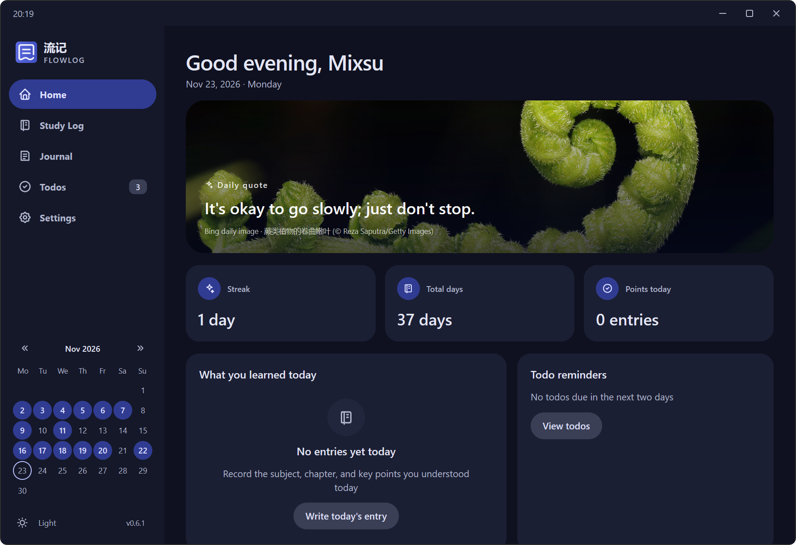
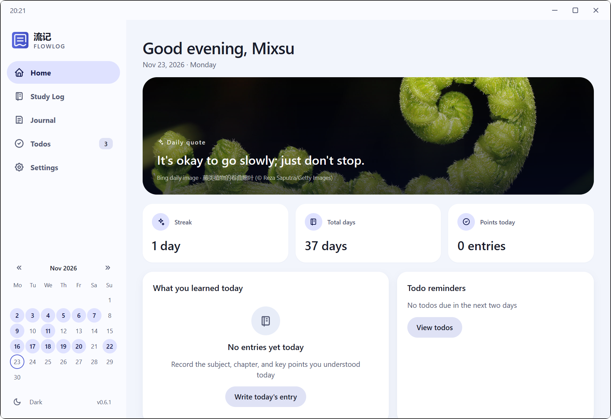
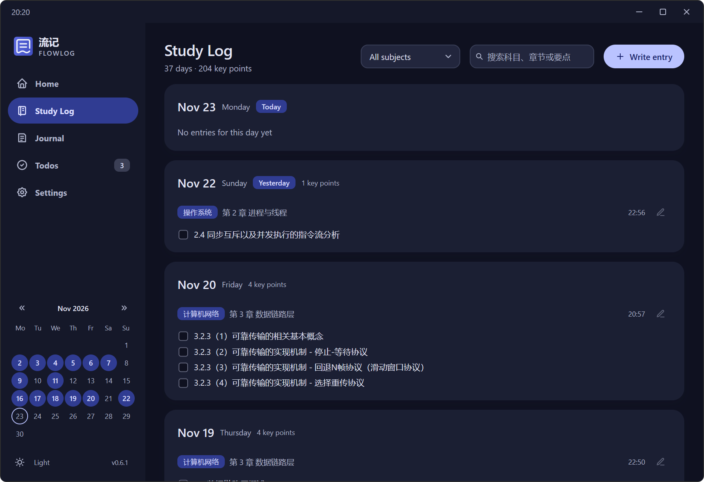
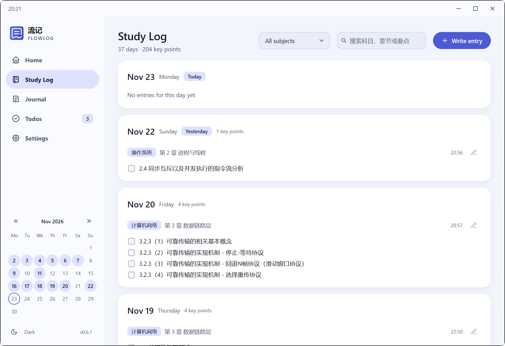
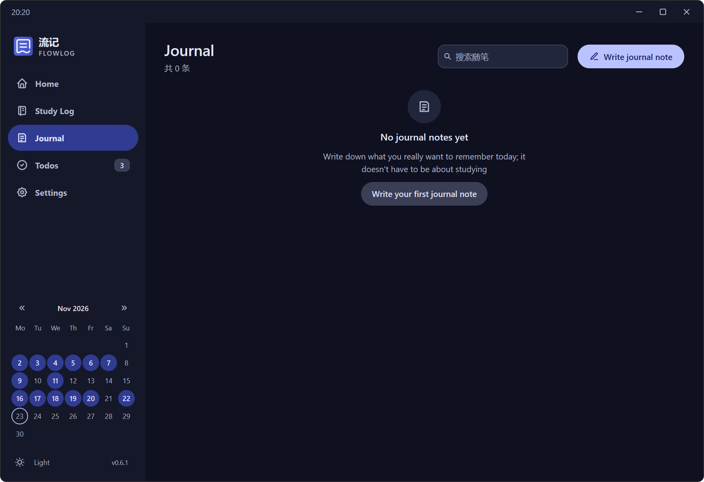
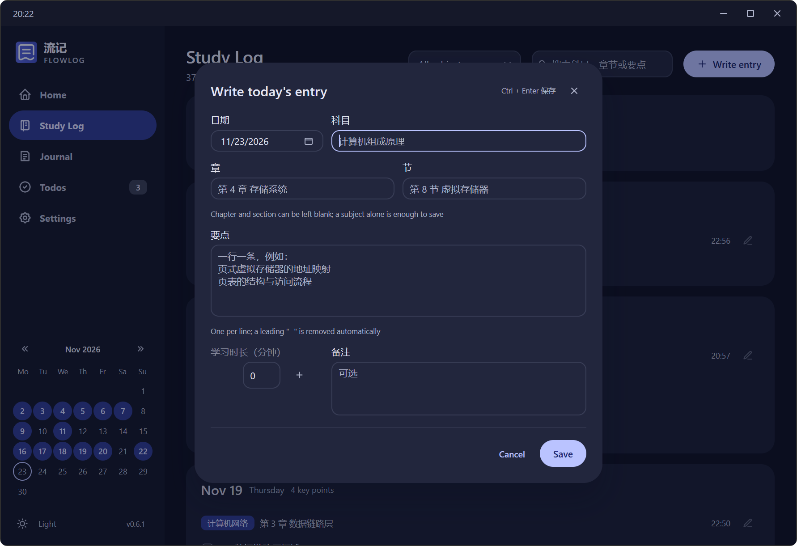
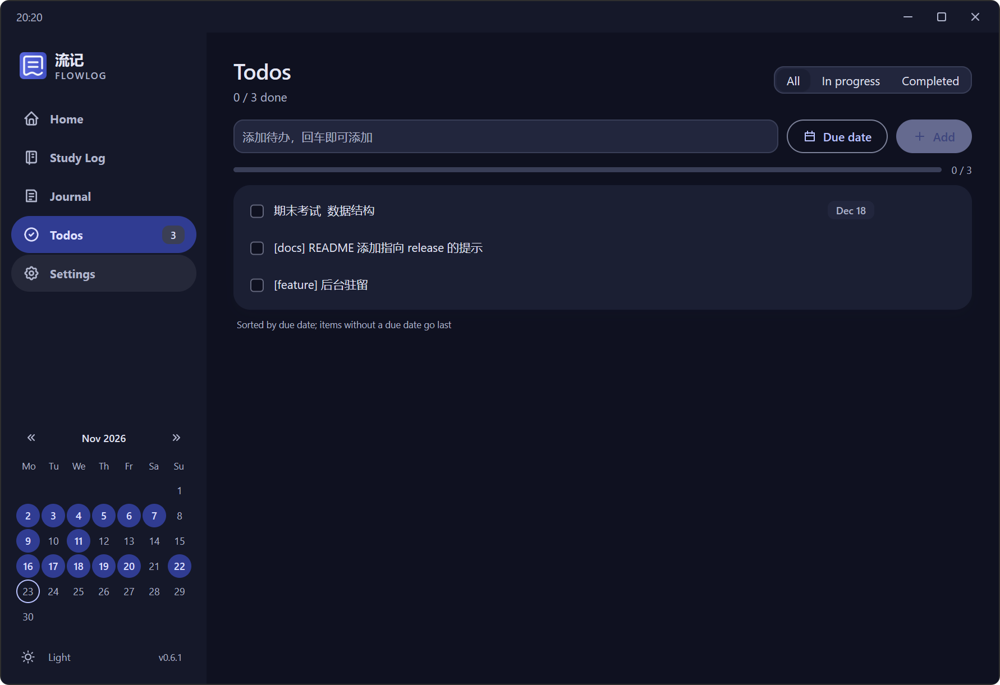
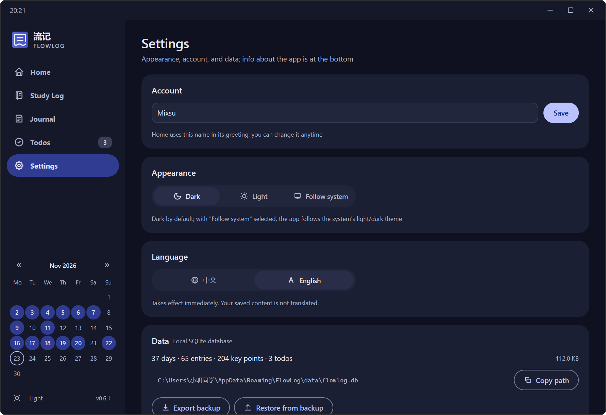

<p align="center">
  
</p>

<h1 align="center">流记 · FlowLog</h1>

<p align="center">⌈ Turn daily study and thoughts into a clear stream ⌋</p>

<p align="center">A desktop app for recording daily study: organize study notes by subject, chapter, and key points, and keep simple journals and todos</p>

<p align="center">
  <a href="README.md">简体中文</a> ·
  <a href="README-en.md">English</a>
</p>

<p align="center">The developer is just a university student. This project is intended only as a small local tool; please be understanding if it falls short.</p>

<p align="center">Developed with DeepSeek Harness and the DeepSeek V4.1 Flash model</p>

<p align="center">
  <a href="https://awesomemygo.dev/apps/flowlog">
    
  </a>
</p>

<p align="center">
  
  
  
  
  
</p>

FlowLog is built using MyGo's native UI mode: the interface is described in Go code and rendered by MyGo on the GPU, without loading a WebView.

The UI follows a Material Design 3-like style: primary colors, container levels, corner radii, and motion are all organized according to MD3 roles.

## ◈ Features

| Module    | Description                                                                                                                                                                                                                                      |
| --------- | ------------------------------------------------------------------------------------------------------------------------------------------------------------------------------------------------------------------------------------------------ |
| Home      | Daily quote (with Bing's daily image as the background), consecutive recording days, today's key points, todo reminders (due today and tomorrow)                                                                                                 |
| Study Log | Record cards in reverse chronological order; a record contains subject, chapter, section, several key points, and notes; key points can be marked as reviewed; supports filtering by subject and full-text search, with matched text highlighted |
| Journal   | A column of journal entries in reverse chronological order, recording what you really want to write down each day; supports search, edit, and delete, independent of study notes                                                                 |
| Todos     | All todos; set a due date for each and sort by due date; supports checking, copying, deleting (undoable), and filtering by status                                                                                                                |
| Sidebar   | How many records were made today and how many todos remain; the calendar marks days with records, and clicking a day jumps directly to that day's study notes                                                                                    |
| Settings  | Name, light/dark mode, UI language (Chinese / English), data backup and restore, automatic backup, shortcuts, about, and version updates                                                                                                         |
| Window    | Custom title bar: current time on the left, minimize / maximize / close at the top right; the whole bar is draggable and double-click maximizes                                                                                                  |

## ◈ Screenshots

| Home · Dark (Default)                  | Home · Light                                  |
| -------------------------------------- | --------------------------------------------- |
|  |  |

| Study Notes                                    | Study Notes · Light                                   |
| ---------------------------------------------- | ----------------------------------------------------- |
|  |  |

| Journal                                      | Write Study Note                                          |
| -------------------------------------------- | --------------------------------------------------------- |
|  |  |

| Todos                                   | Settings                                       |
| --------------------------------------- | ---------------------------------------------- |
|  |  |

## ◈ Requirements

- Go 1.27 or later
- MyGo CLI: the project pins the version as a `tool` dependency in `go.mod`; call it directly with `go tool mygo`, no separate installation required
- Building installers requires platform tools such as NSIS (Windows installer); see the [MyGo distribution docs](https://mygo.run/docs/distribution)

## ◈ Development

```bash
go tool mygo dev      # Compile, launch the app, and automatically restart after Go code changes
go test ./...         # Unit tests and UI interaction tests
go vet ./...          # Static checks
gofmt -l .            # Check formatting
```

UI previews are rendered as PNGs during tests (one each for light, dark, filtering, and dialogs):

```bash
go test ./internal/view -run TestPreview -v
```

## ◈ Build

```bash
go tool mygo build                 # Current platform
go tool mygo build -platform windows/amd64,darwin/arm64
```

Artifacts are placed in `build/`. Windows produces an installer, macOS produces `.app` and `.dmg`, and Linux produces `.tar.gz` and an install script.

## ◈ Data

The database file is `data/flowlog.db` (SQLite). Its location varies by run mode:

| Run mode                        | Data directory                                                                                                       |
| ------------------------------- | -------------------------------------------------------------------------------------------------------------------- |
| `go tool mygo dev` / `go run .` | `./data` under the project                                                                                           |
| Installed app                   | Windows `%APPDATA%\FlowLog\data`, macOS `~/Library/Application Support/FlowLog/data`, Linux `~/.config/FlowLog/data` |
| `FLOWLOG_DATA` set              | Use that directory (convenient for synced drives)                                                                    |

Schema:

| Table      | Contents                                                            |
| ---------- | ------------------------------------------------------------------- |
| `days`     | Dates with study notes                                              |
| `entries`  | Study records belonging to a day                                    |
| `points`   | Key points belonging to a record                                    |
| `todos`    | Todos: content, completion status, creation date, optional due date |
| `settings` | Key-value settings (appearance, name, automatic backup)             |

Study notes are written transactionally: a save either fully succeeds or fully rolls back. Todos are read and written one by one.

Databases from older versions (0.3 and earlier) are automatically upgraded on startup, and existing data is preserved.

**Backup and Migration**

- **Automatic backup**: on the first launch each day, write all data to `backups/flowlog-auto-<date>-<time>.json`, keeping the latest 14 copies by default; you can turn it off, adjust the number of copies, or back up immediately in Settings.
- **Export backup**: generate a JSON file containing all study notes, todos, and settings.
- **Restore from backup**: select a backup file to overwrite all current data (with a second confirmation); before overwriting, a `flowlog-before-restore-*.json` file is automatically saved, so you can recover if you restore the wrong file.

## ◈ Automatic Updates

The app uses MyGo's update mechanism: update packages are signed with an Ed25519 private key, and the app has the corresponding public key built in. After startup, it automatically checks, downloads, verifies, and replaces files, then restarts to take effect.

### Release Process

1. Change `version` in `mygo.json` and add a `## <version>` section to `CHANGELOG.md`.
2. Commit and tag: `git tag v0.x.x && git push origin v0.x.x`.
3. GitHub Actions reads the CHANGELOG for that version as release notes, creates a draft Release, and builds/uploads artifacts in parallel on three platforms.
4. After all succeed, it publishes automatically; installed apps will see the new version on the next check.

The workflow is at [.github/workflows/release.yml](.github/workflows/release.yml).

### One-time Configuration

In the repository's **Settings → Secrets and variables → Actions**, add:

| Secret                     | Content                                     |
| -------------------------- | ------------------------------------------- |
| `MYGO_UPDATER_PRIVATE_KEY` | Full contents of the `mygo-update.key` file |

The private key is generated by `go tool mygo keygen` and is located by default under `mygo/update-keys/` in the user config directory.

Loss of the private key means you can no longer push updates to installed users; back it up carefully.

Optional (official signing to avoid macOS Gatekeeper and Windows SmartScreen blocks): see [MyGo app signing](https://mygo.run/docs/github-actions).

### How Updates Take Effect

- Installed apps check every 24 hours; you can also check manually on the Settings page.
- After a new version is found, you can download and install it directly on the Settings page; the app restarts automatically after installation.
- Only updates signed with the same private key are accepted.
- Development builds (`mygo dev`, `go run`) and package-manager-installed versions do not participate in automatic updates; users can also manually download new versions from Releases.

## ◈ Project Structure

```text
main.go                  Startup, window, database open/close, release notes
internal/model/          Data structures (Day / Entry / Point / Todo / Settings)
internal/store/          SQLite read/write, schema upgrades, backup export and restore
internal/design/         Design system: MD3 color palette, font sizes, corner radii, motion, icons, base components
internal/app/            App state and actions: study notes, todos, settings, backup, updates, background image
internal/pages/          Five pages: Home, Study Notes (including filtering and edit dialogs), Journal, Todos, Settings
internal/view/           Window shell: root view, sidebar, calendar, global overlays, shortcuts
resources/               App icon (also embedded into the program)
docs/                    Development notes and UI screenshots
.github/workflows/       Three-platform release workflow
```

The dependency direction is one-way: `design ← app ← pages ← view ← main`.

Pages only read state and call actions; the state layer does not draw the UI; the design system knows nothing about business logic.

In the `docs` folder, the `showPNG` folder is used for screenshots displayed in the README, and the `screenshots` folder is used for generated UI test screenshots.

## ◈ Known Limitations

- Automatic updates depend on GitHub Releases and require the repository to be public or use an accessible HTTPS address.
- Currently only supports a single window and local single-user data.

## ◈ License

[MIT](LICENSE)
