<p align="center">
  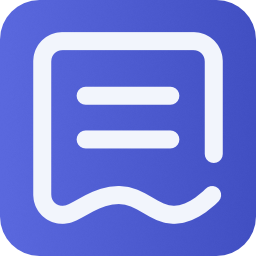
</p>

<h1 align="center">FlowLog · 流记</h1>

<p align="center">A desktop app for logging daily study: organize study logs by subject, chapter, and key points, with daily todos.</p>

<p align="center">
  <a href="README.md">简体中文</a> ·
  <a href="README-en.md">English</a>
</p>

<p align="center">The developer is still a college student, and this project is intended as a small local tool. Please be forgiving if it falls short.</p>

<p align="center">Built with DeepSeek Harness and the DeepSeek V4.1 Flash model.</p>

<p align="center">
  
  
  
  
  
</p>

FlowLog is built with [MyGo](https://mygo.run)'s native UI mode: the interface is described in Go code and rendered by MyGo on the GPU. It does not load a WebView and has no HTML, JavaScript, or frontend build step.

The UI follows a Material Design 3-like style: primary colors, container levels, corner radii, and motion are organized by MD3 roles.

## ◈ Features

| Module    | Description                                                                                                                                                                                                                    |
| --------- | ------------------------------------------------------------------------------------------------------------------------------------------------------------------------------------------------------------------------------ |
| Home      | Daily quote (with Bing's daily wallpaper as background), streak days, today's key points, and todo reminders (due today and tomorrow)                                                                                          |
| Study Log | Cards sorted by date descending; each entry contains subject, chapter, section, several key points, and a note. Key points can be marked as reviewed; supports subject filtering and full-text search with highlighted matches |
| Journal   | A reverse-chronological list of daily journal notes—the things you really want to write down each day. Supports search, edit, and delete; independent of Study Log                                                             |
| Todos     | All todos in one list; optional due date per item; sorted by due date; supports checking, copying, deleting (undoable), and filtering by status                                                                                |
| Sidebar   | Number of entries today and remaining todos; the month calendar marks days with entries; click a day to jump to that day's Study Log                                                                                           |
| Settings  | Name, Appearance (with icons), Interface Language (Chinese / English), Data Backup and Restore, Automatic Backup, Shortcuts, About and Version Updates                                                                         |
| Window    | Custom Title Bar: Current time on the left, Minimize / Maximize / Close on the top right; whole bar draggable, double-click to maximize                                                                                        |

## ◈ Screenshots

| Home · Dark (default)              | Home · Light                                   |
| ---------------------------------- | ---------------------------------------------- |
| 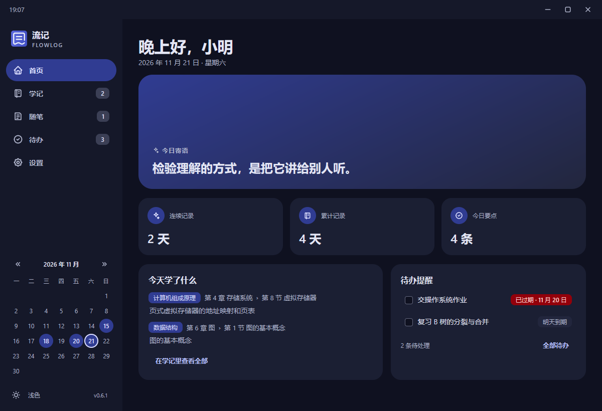 | 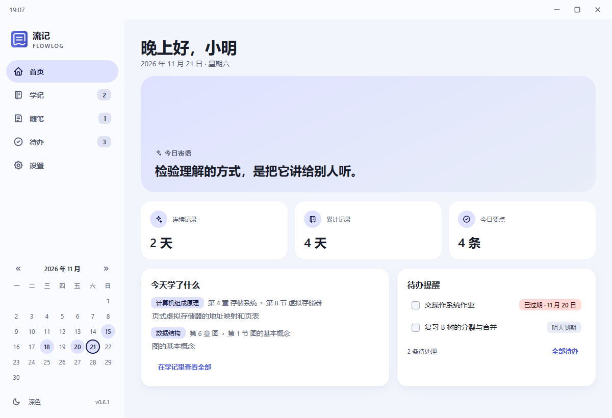 |

| Study Log                                | Study Log · Light                                    |
| ---------------------------------------- | ---------------------------------------------------- |
| 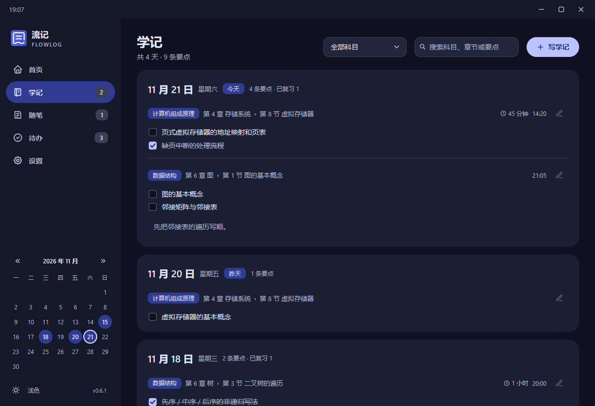 | 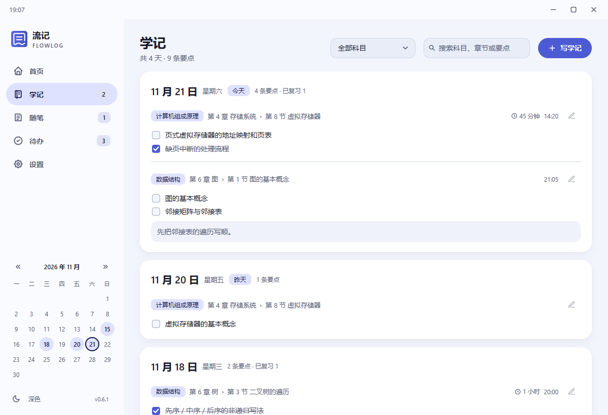 |

| Journal                                | Write a Journal Note                                      |
| -------------------------------------- | --------------------------------------------------------- |
| 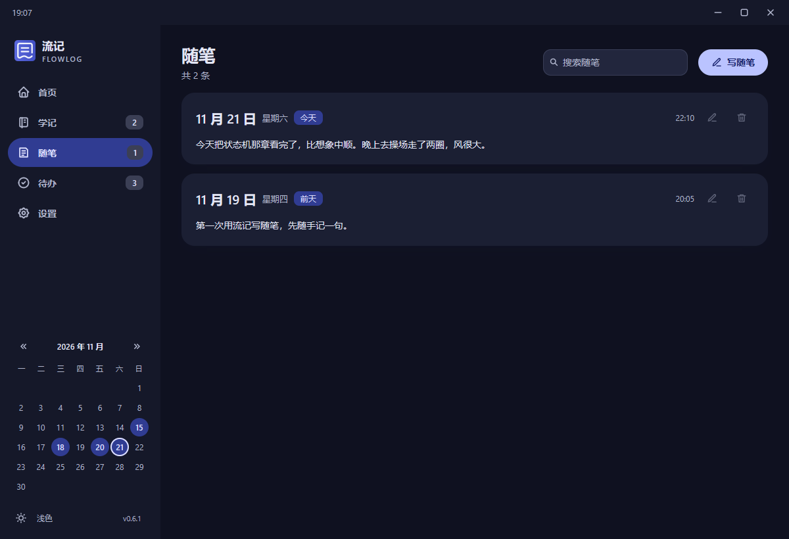 | 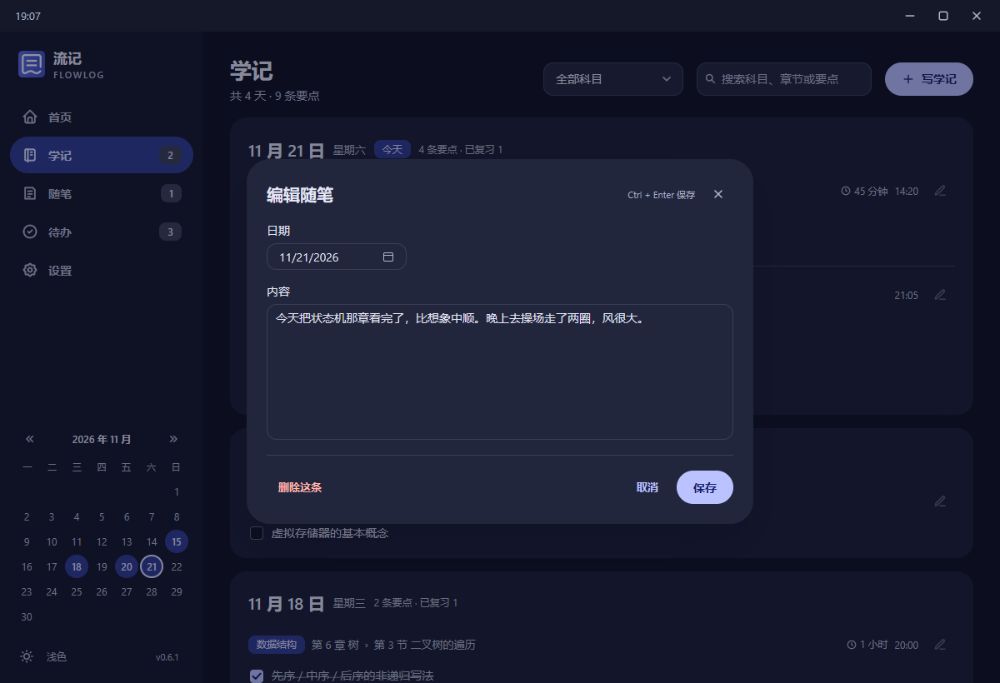 |

| Todos                               | Settings                                   |
| ----------------------------------- | ------------------------------------------ |
| 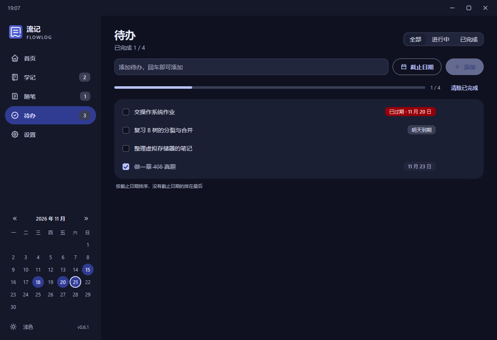 | 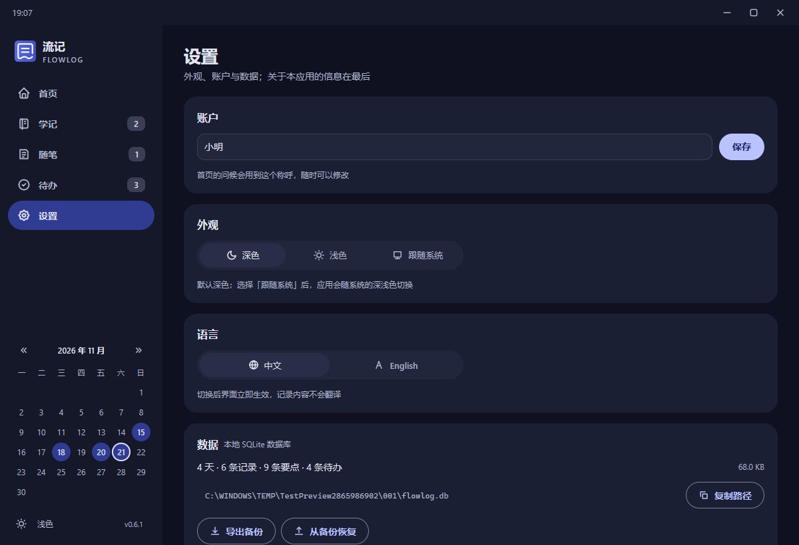 |

| Search Highlight                                       | Write a Study Entry                                 |
| ------------------------------------------------------ | --------------------------------------------------- |
| 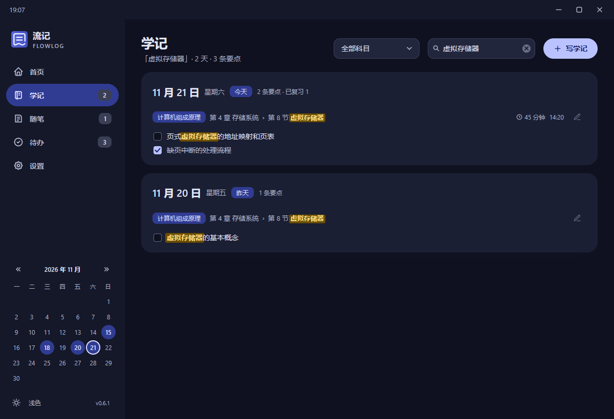 | 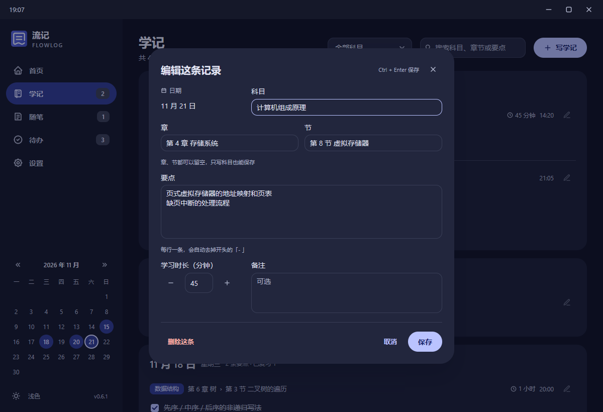 |

## ◈ Requirements

- Go 1.27 or later
- MyGo CLI: the project pins it as a `tool` dependency in `go.mod`. Invoke it with `go tool mygo`; no separate installation is required.
- Building installers requires platform tools such as NSIS (Windows installer). See the [MyGo distribution docs](https://mygo.run/docs/distribution).

## ◈ Development

```bash
go tool mygo dev      # Compile, launch the app, and restart on Go code changes
go test ./...         # Unit tests and UI interaction tests
go vet ./...          # Static checks
gofmt -l .            # Check formatting
```

UI previews are rendered as PNGs during tests (light, dark, filtering, and modal previews):

```bash
go test ./internal/view -run TestPreview -v
```

## ◈ Build

```bash
go tool mygo build                 # Current platform
go tool mygo build -platform windows/amd64,darwin/arm64
```

Artifacts are placed in `build/`. Windows produces an installer, macOS produces `.app` and `.dmg`, and Linux produces `.tar.gz` and an install script.

## ◈ Data

The database file is `data/flowlog.db` (SQLite). Its location depends on how the app is run:

| How it runs                     | Data directory                                                                                                       |
| ------------------------------- | -------------------------------------------------------------------------------------------------------------------- |
| `go tool mygo dev` / `go run .` | `./data` under the project                                                                                           |
| Installed app                   | Windows `%APPDATA%\FlowLog\data`, macOS `~/Library/Application Support/FlowLog/data`, Linux `~/.config/FlowLog/data` |
| `FLOWLOG_DATA` is set           | Use that directory (handy for a synced drive)                                                                        |

Schema:

| Table      | Contents                                                          |
| ---------- | ----------------------------------------------------------------- |
| `days`     | Dates that have study logs                                        |
| `entries`  | Study entries belonging to a day                                  |
| `points`   | Key points belonging to an entry                                  |
| `todos`    | Todos: content, completion state, created date, optional due date |
| `settings` | Key-value settings (appearance, display name, auto backup)        |

Study-log writes are transactional: a save either fully succeeds or fully rolls back. Todos are read and written one by one.

Databases from older versions (0.3 and earlier) are upgraded automatically on startup; existing data is preserved.

**Backup and migration**

- **Auto backup**: on the first launch each day, all data is written to `backups/flowlog-auto-<date>-<time>.json`. The latest 14 backups are kept by default; you can disable it, adjust the count, or back up immediately in Settings.
- **Export backup**: generates a JSON file containing all study logs, todos, and settings.
- **Restore from backup**: choose a backup file and overwrite all current data (with a second confirmation). Before overwriting, a `flowlog-before-restore-*.json` file is saved automatically, so you can recover if you restore the wrong file.

## ◈ Auto Update

The app uses MyGo's update mechanism: update packages are signed with an Ed25519 private key, and the corresponding public key is embedded in the app. On startup, the app checks for updates, downloads, verifies, and replaces files, then restarts.

### Release Process

1. Update `version` in `mygo.json` and add a `## <version>` section to `CHANGELOG.md`.
2. Commit and tag: `git tag v0.x.x && git push origin v0.x.x`.
3. GitHub Actions reads that version's CHANGELOG as release notes, creates a draft Release, and builds and uploads artifacts in parallel on three platforms.
4. Once all jobs succeed, the release is published automatically; installed apps will see the new version on their next check.

Workflow: [.github/workflows/release.yml](.github/workflows/release.yml).

### One-time Setup

In the repository's **Settings → Secrets and variables → Actions**, add:

| Secret                     | Value                              |
| -------------------------- | ---------------------------------- |
| `MYGO_UPDATER_PRIVATE_KEY` | Full contents of `mygo-update.key` |

The private key is generated by `go tool mygo keygen` and is stored by default under the user config directory at `mygo/update-keys/`.

If the private key is lost, you will no longer be able to push updates to installed users. Back it up carefully.

Optional (official signing, to avoid macOS Gatekeeper and Windows SmartScreen blocks): see [MyGo app signing](https://mygo.run/zh/docs/github-actions).

### How Updates Work

- Installed apps check every 24 hours; you can also check manually in Settings.
- When a new version is found, you can download and install it directly from Settings; the app restarts automatically after installation.
- Only updates signed with the same private key are accepted.
- Development builds (`mygo dev`, `go run`) and package-manager installs do not participate in auto-update; users can also download new versions manually from Releases.

## ◈ Project Structure

```text
main.go                  Startup, window, database open/close, release notes
internal/model/          Data structures (Day / Entry / Point / Todo / Settings)
internal/store/          SQLite read/write, schema upgrades, backup export and restore
internal/design/         Design system: MD3 palette, font sizes, radii, motion, icons, base components
internal/app/            App state and actions: study logs, todos, settings, backups, updates, background image
internal/pages/          Five pages: Home, Study Log (with filtering and editor modal), Journal, Todos, Settings
internal/view/           Window shell: root view, sidebar, month calendar, global overlays, shortcuts
resources/               App icon (also embedded in the binary)
docs/                    Development notes and UI screenshots
.github/workflows/       Three-platform release workflow
```

The dependency direction is one-way: `design ← app ← pages ← view ← main`.

Pages only read state and call actions; the state layer does not draw UI; the design system knows nothing about business logic.

## ◈ Known Limitations

- UI text is in Chinese; built-in controls (calendar, number input) already display with the Chinese language pack.
- Auto-update depends on GitHub Releases; the repository must be public or use an accessible HTTPS URL.
- Currently only single-window, local single-user data is supported.

## ◈ License

[MIT](LICENSE)
